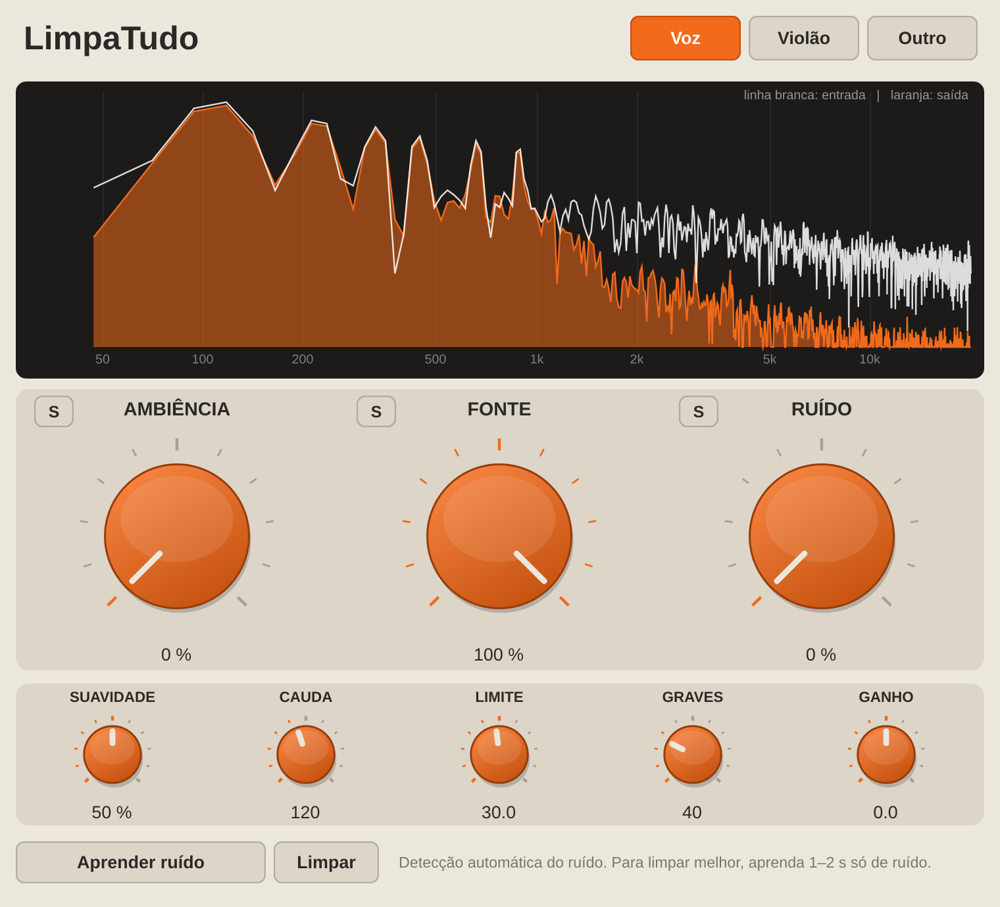

# LimpaTudo (VST3)

Plugin de limpeza de áudio para gravações com microfone: **voz, violão ou qualquer outra fonte**.
Faz três coisas ao mesmo tempo: **De-Noise** (tira ruído), **De-Reverb** (tira a "sala") e
**De-Voice/Instrumento** (separa a fonte principal).

## Como instalar (Windows)

1. No GitHub, abra **Releases** (lado direito da página do repositório) e baixe **LimpaTudo-Setup.exe**.
2. Dê dois cliques e siga o assistente. Ele já instala tudo em `C:\Program Files\Common Files\VST3`.
3. Abra a DAW e reescaneie os plugins VST3 (se não aparecer sozinho).

> Se a Release ainda não existir: aba **Actions** → última execução → artefato **LimpaTudo-Setup**
> (o GitHub entrega dentro de um .zip; extraia e clique no .exe).

## Como usar

1. Escolha o **modo** no canto superior direito: **Voz**, **Violão** ou **Outro**.
2. Toque o áudio. Já vem limpando: Fonte 100 %, Ambiência 0, Ruído 0.
3. Ajuste os 3 knobs grandes:
   - **AMBIÊNCIA** — todo à esquerda não mexe em nada; girando para a direita remove a ambiência/reverb (de-verb), deixando o áudio mais seco.
   - **FONTE** — volume da voz/instrumento principal. Todo à esquerda = fonte muda.
   - **RUÍDO** — todo à esquerda = zero ruído. Girando para a direita devolve, aos poucos, o ruído original.
   - O botão **S** de cada knob deixa você **ouvir só aquela parte** (fonte, ambiência ou ruído) — ótimo para checar o que está sendo tirado. Clique de novo para voltar.
4. Se sobrar ruído constante (ventoinha, ar-condicionado): clique **Aprender ruído**, toque 1–2 s de áudio **só com o ruído** (sem tocar nem falar), clique de novo. O perfil fica salvo no projeto.

### Controles para dosar os "glitches" (ajuste fino)

| Controle | O que faz | Se aparecer glitch… |
|---|---|---|
| **Suavidade** | Suaviza a máscara de limpeza (acaba com o "chiado de passarinho") | aumente |
| **Cauda** | Tempo que a limpeza demora para fechar depois de um som | aumente (som mais natural) |
| **Limite** | Máximo de ruído que pode ser removido (dB) | diminua (limpeza mais gentil) |
| **Graves** | Filtro passa-altas (20 Hz = desligado) | — |
| **Ganho** | Volume de saída | — |

São 10 parâmetros no total: Ambiência, Fonte, Ruído, Modo, Ouvir (S), Suavidade, Cauda, Limite, Graves e Ganho.

## Como funciona

A entrada é dividida em três partes que **somam exatamente o áudio original**: Fonte + Ambiência + Ruído.
Com Fonte 100 %, Ambiência 0 e Ruído 100 %, a saída é idêntica à entrada (testado: erro menor que −130 dB).
Assim, os erros do estimador nunca "vazam" para o áudio se você não mexer nos knobs.

- **Voz:** rede neural RNNoise (Xiph/Mozilla, BSD) para a máscara de ruído.
- **Violão / Outro:** estimador espectral (mínimos estatísticos + Wiener) ou o ruído que você aprendeu. Mantém os harmônicos de notas sustentadas e abre a máscara antes dos ataques (olha ~11 ms à frente).
- **De-reverb:** subtração espectral da cauda tardia da sala.

Latência: ~62 ms a 48 kHz (o plugin avisa a DAW, que compensa sozinha). Mono e estéreo; qualquer taxa de amostragem (reamostra internamente para 48 kHz — o ideal é projeto a 48 kHz).

## Compilar / testar

- O GitHub Actions compila o plugin e gera o instalador a cada envio (`.github/workflows/build-windows.yml`).
- Testes do motor (sem JUCE): veja o cabeçalho de `tests/test_core.cpp`.

## Licenças

RNNoise: BSD (`third_party/rnnoise/COPYING`). JUCE: AGPLv3/comercial — uso pessoal tudo bem;
para vender o plugin é preciso respeitar a licença do JUCE.
